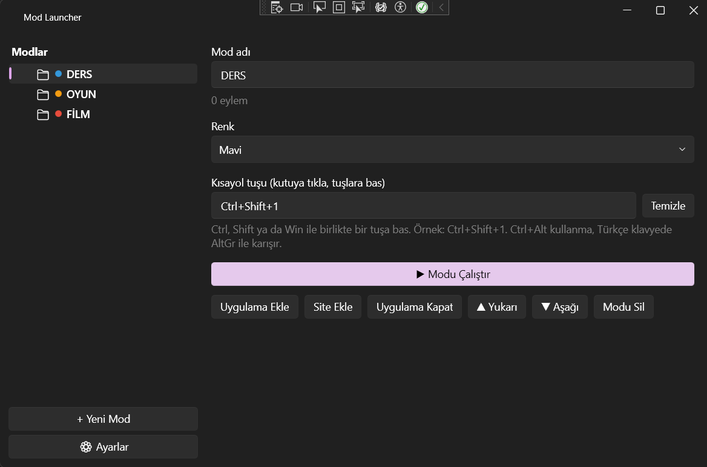

# Mod Launcher

Tek tıkla bir "mod" (profil) çalıştır: ders çalışırken ders uygulamalarını ve siteleri aç, oyun oynarken oyun başlatıcını aç, dikkatini dağıtan uygulamaları kapat. Windows 11 için Mica görünümlü, hafif bir WPF masaüstü uygulaması.



## Özellikler

- **Modlar:** İstediğin kadar mod oluştur. Her mod bir klasör gibi, içinde eylemleri var.
- **Üç eylem türü:** uygulama aç, site aç, çalışan bir uygulamayı kapat.
- **Tarayıcı seçimi:** Siteleri istediğin tarayıcıdan aç, genel olarak ya da eylem başına.
- **Kısayol tuşları:** Her moda genel bir kısayol ata (örn. `Ctrl+Shift+1`), uygulama tepsideyken bile çalışır.
- **Sistem tepsisi:** Saatin yanından tek tıkla mod çalıştır, pencereyi kapatınca tepside bekle.
- **Windows ile başlat:** Bilgisayar açılınca hazır olsun.
- **Tema:** Windows'un koyu/açık temasını takip et ya da sabit seç, Mica efektiyle.
- **Yedekleme:** Modları JSON dosyasına dışa aktar, başka bir bilgisayarda içe aktar.
- **Kolay düzenleme:** Mod renkleri, ▲/▼ ile sıralama, eylemi tek başına deneme.

## Kurulum

1. [Releases](https://github.com/bugraefe48/ModLauncher/releases) sayfasından son sürümün `ModLauncher-win-x64.zip` dosyasını indir.
2. Zip'i bir klasöre çıkar ve `ModLauncher.exe`'yi çalıştır. Kurulum ya da .NET yüklemesi gerekmez.

> **Not:** Uygulama dijital olarak imzalı değil. Windows SmartScreen "Windows bilgisayarınızı korudu" uyarısı gösterirse **Daha fazla bilgi > Yine de çalıştır**'ı seç. Akıllı Uygulama Denetimi (Smart App Control) açıksa imzasız uygulamaları engelleyebilir. Bu durumda uygulamayı aşağıdaki gibi kaynaktan derleyebilirsin.

## Kullanım

1. **+ Yeni Mod** ile bir mod oluştur ve adını yaz.
2. **Uygulama Ekle**, **Site Ekle** ya da **Uygulama Kapat** ile eylemleri ekle. Sırayı ▲/▼ ile ayarla (örn. önce kapat, sonra aç).
3. **▶ Modu Çalıştır**'a bas ya da moda bir kısayol tuşu ata.
4. **⚙ Ayarlar**'dan tema, genel tarayıcı, tepsi ve Windows ile başlatma seçeneklerini ayarla.

Kısayol tuşu olarak `Ctrl+Alt` kombinasyonu kullanılamaz, Türkçe klavyede `AltGr` ile aynı olduğu için `@`, `{`, `[` gibi karakterleri bozar. `Ctrl+Shift` kullan.

Tepsi menüsünden ya da kısayol tuşuyla çalıştırılan modlar onay sormaz. Ayarlardaki "onay sor" seçeneği sadece pencereden çalıştırmayı etkiler. Modları dosyadan içe aktarırken, dosyadaki programları çalıştırmadan önce onay istenir. Sadece güvendiğin kişilerden aldığın dosyaları içe aktar.

## Verilerin yeri

Modlar ve ayarlar `%AppData%\ModLauncher\data.json` dosyasında tutulur. Uygulamayı silmek bu dosyayı silmez.

## Kaynaktan derleme

Gereksinimler: Visual Studio 2022 ya da üstü ("**.NET masaüstü geliştirme**" iş yüküyle) ve .NET 10 SDK.

```bash
git clone https://github.com/bugraefe48/ModLauncher.git
cd ModLauncher
dotnet build -c Release
```

Tek dosyalık çalıştırılabilir sürüm için:

```bash
dotnet publish ModLauncher/ModLauncher.csproj -c Release -r win-x64 --self-contained true -p:PublishSingleFile=true -p:IncludeNativeLibrariesForSelfExtract=true -p:EnableCompressionInSingleFile=true
```

## Kullanılan kütüphaneler

- [WPF-UI](https://github.com/lepoco/wpfui) (MIT), Windows 11 görünümü ve Mica efekti için

## Lisans

[MIT](LICENSE.txt)Mod Launcher


Tek tıkla bir "mod" (profil) çalıştır: ders çalışırken ders uygulamalarını ve siteleri aç, oyun oynarken oyun başlatıcını aç, dikkatini dağıtan uygulamaları kapat. Windows 11 için Mica görünümlü, hafif bir WPF masaüstü uygulaması.


!\[Mod Launcher ekran görüntüsü](docs/screenshot.png)


\## Özellikler


\- \*\*Modlar:\*\* İstediğin kadar mod oluştur. Her mod bir klasör gibi, içinde eylemleri var.

\- \*\*Üç eylem türü:\*\* uygulama aç, site aç, çalışan bir uygulamayı kapat.

\- \*\*Tarayıcı seçimi:\*\* Siteleri istediğin tarayıcıdan aç, genel olarak ya da eylem başına.

\- \*\*Kısayol tuşları:\*\* Her moda genel bir kısayol ata (örn. `Ctrl+Shift+1`), uygulama tepsideyken bile çalışır.

\- \*\*Sistem tepsisi:\*\* Saatin yanından tek tıkla mod çalıştır, pencereyi kapatınca tepside bekle.

\- \*\*Windows ile başlat:\*\* Bilgisayar açılınca hazır olsun.

\- \*\*Tema:\*\* Windows'un koyu/açık temasını takip et ya da sabit seç, Mica efektiyle.

\- \*\*Yedekleme:\*\* Modları JSON dosyasına dışa aktar, başka bir bilgisayarda içe aktar.

\- \*\*Kolay düzenleme:\*\* Mod renkleri, ▲/▼ ile sıralama, eylemi tek başına deneme.


\## Kurulum


1\. \[Releases](https://github.com/bugraefe48/ModLauncher/releases) sayfasından son sürümün `ModLauncher-win-x64.zip` dosyasını indir.

2\. Zip'i bir klasöre çıkar ve `ModLauncher.exe`'yi çalıştır. Kurulum ya da .NET yüklemesi gerekmez.


> \*\*Not:\*\* Uygulama dijital olarak imzalı değil. Windows SmartScreen "Windows bilgisayarınızı korudu" uyarısı gösterirse \*\*Daha fazla bilgi > Yine de çalıştır\*\*'ı seç. Akıllı Uygulama Denetimi (Smart App Control) açıksa imzasız uygulamaları engelleyebilir. Bu durumda uygulamayı aşağıdaki gibi kaynaktan derleyebilirsin.


\## Kullanım


1\. \*\*+ Yeni Mod\*\* ile bir mod oluştur ve adını yaz.

2\. \*\*Uygulama Ekle\*\*, \*\*Site Ekle\*\* ya da \*\*Uygulama Kapat\*\* ile eylemleri ekle. Sırayı ▲/▼ ile ayarla (örn. önce kapat, sonra aç).

3\. \*\*▶ Modu Çalıştır\*\*'a bas ya da moda bir kısayol tuşu ata.

4\. \*\*⚙ Ayarlar\*\*'dan tema, genel tarayıcı, tepsi ve Windows ile başlatma seçeneklerini ayarla.


Kısayol tuşu olarak `Ctrl+Alt` kombinasyonu kullanılamaz, Türkçe klavyede `AltGr` ile aynı olduğu için `@`, `{`, `\[` gibi karakterleri bozar. `Ctrl+Shift` kullan.


\## Verilerin yeri


Modlar ve ayarlar `%AppData%\\ModLauncher\\data.json` dosyasında tutulur. Uygulamayı silmek bu dosyayı silmez.


\## Kaynaktan derleme


Gereksinimler: Visual Studio 2022 ya da üstü ("\*\*.NET masaüstü geliştirme\*\*" iş yüküyle) ve .NET 10 SDK.


```bash

git clone https://github.com/bugraefe48/ModLauncher.git

cd ModLauncher

dotnet build -c Release

```


Tek dosyalık çalıştırılabilir sürüm için:


```bash

dotnet publish ModLauncher/ModLauncher.csproj -c Release -r win-x64 --self-contained true -p:PublishSingleFile=true -p:IncludeNativeLibrariesForSelfExtract=true -p:EnableCompressionInSingleFile=true

```


\## Kullanılan kütüphaneler


\- \[WPF-UI](https://github.com/lepoco/wpfui) (MIT), Windows 11 görünümü ve Mica efekti için


\## Lisans


\[MIT](LICENSE.txt)

